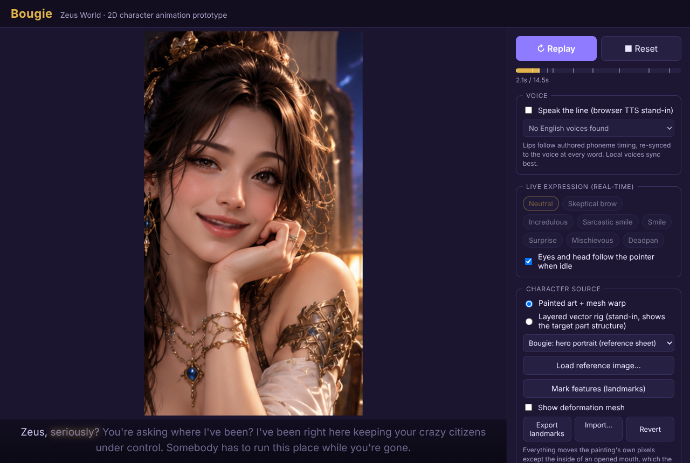
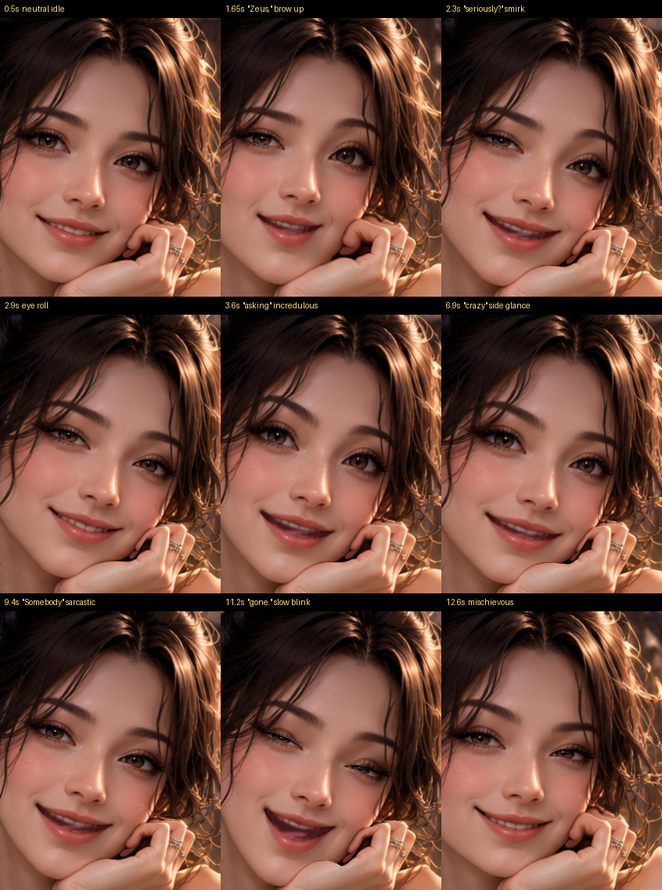
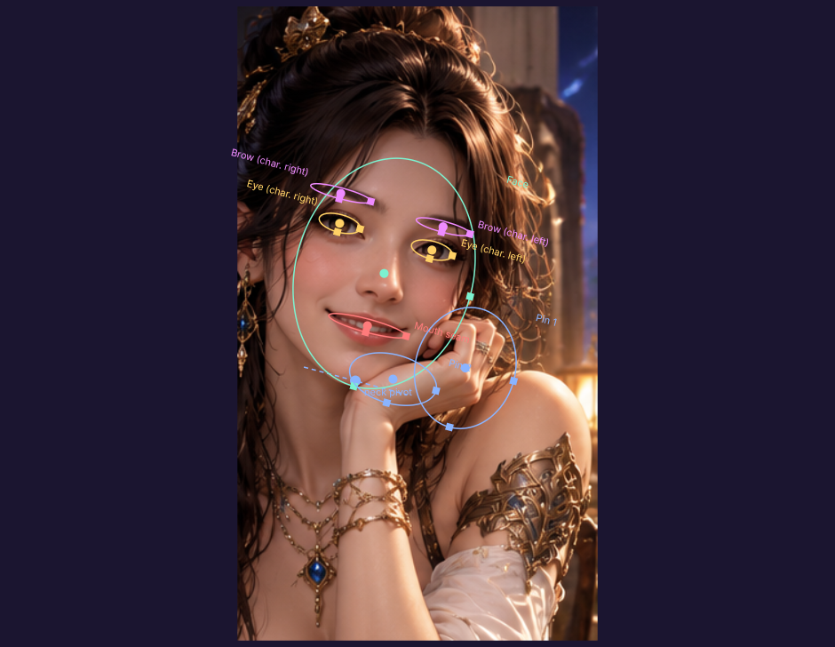

# Bougie: Zeus World 2D character animation prototype

A local browser app (React + TypeScript + PixiJS) that animates **Bougie from the
reference artwork** in real time. It is not a video: every frame is computed from a
parameter rig, with blinking, eye movement, expressive brows, smile, surprise and
sarcastic expressions, lip sync, and smooth blended transitions.



**The performance (14.5 s):** starts neutral → left brow shoots up on "Zeus," →
sarcastic smirk on "seriously?" → eye roll → incredulous "You're asking where I've been?" →
confident "I've been right here…", with a side glance at "crazy citizens" → sarcastic
"Somebody has to run this place" → slow lidded blink on "gone." → mischievous smile →
back to idle.



## Install and run on Windows

1. Install **Node.js 20 LTS or newer** from https://nodejs.org (the default installer options are fine).
2. Get the code: either install Git from https://git-scm.com and run
   `git clone https://github.com/bala1237/zeus-scripts.git`, or download the repo as a ZIP from
   GitHub and unzip it.
3. Open **PowerShell** (or Command Prompt) in the project folder:
   ```powershell
   cd zeus-scripts\bougie-prototype
   npm install
   npm run dev
   ```
4. Your browser opens at **http://localhost:5173**. Press **▶ Play**, and **■ Reset** to return to idle.

Use **Chrome or Edge** for the voice. Windows' built-in local voices (e.g. "Microsoft Zira", "Microsoft David")
report word timing, so the lips lock to the voice. The voice
picker is in the side panel. Online voices often don't report timing; in that case the
lip sync runs on its authored clock.

To build a static copy: `npm run build`, then `npm run preview` (output in `dist/`).

If PowerShell refuses to run `npm` ("running scripts is disabled"), use Command Prompt instead,
or run `Set-ExecutionPolicy -Scope CurrentUser RemoteSigned` once.

## What's in the app

| Control | What it does |
|---|---|
| ▶ Play / ↻ Replay, ■ Reset | Runs the 14.5 s performance; Reset returns to neutral idle. |
| Voice | Speaks the line with browser TTS (a stand-in for a recorded voice) and syncs to it. |
| Live expression | Blends to any expression in real time while idle: the real-time path. |
| Eyes follow pointer | Eyes and head track the mouse when idle. |
| Character source | **Painted art + mesh warp**: the hero portrait (default), the front view, or a flattened stand-in. **Layered vector rig**: a stand-in showing the part structure the art should be split into. |
| Load reference image… / Mark features | Animate any portrait: drag the feature ellipses, set the head tilt, add pins for hands or props, then export the landmarks JSON. |
| Show deformation mesh | Shows the warp mesh. |



## Honest summary

The sheet is flat, AI-painted art. Its panels are separate paintings rather than aligned frames.
Warping one painting gets convincing blinks, brows, smiles and moderate lip sync while
keeping the exact look. It can't get large head turns, a real eye roll, a wide-open mouth with
real teeth, or hair physics. Details in [docs/ARTWORK_ASSESSMENT.md](docs/ARTWORK_ASSESSMENT.md).

- Technology choice (Live2D vs PixiJS vs mesh): [docs/TECH_EVALUATION.md](docs/TECH_EVALUATION.md)
- Path to real-time interaction: [docs/NEXT_STEPS.md](docs/NEXT_STEPS.md)

## Project layout

```
src/
  rig/params.ts          parameter model (Live2D-compatible IDs)
  rig/math.ts            springs, noise, easing
  anim/idle.ts           blinks, saccades, breathing, head wander
  anim/expressions.ts    blendable expression presets
  anim/performance.ts    the acted 14.5 s timeline
  anim/animator.ts       blends all layers into parameters each frame
  speech/dialogue.ts     the line, word timing, phonemes
  speech/visemes.ts      phoneme → mouth pose with coarticulation
  speech/tts.ts          browser voice with word-boundary sync
  render/FlatImageRig.ts mesh warp of painted art
  render/BougieRig.ts    layered vector stand-in rig
  render/landmarks.ts    feature landmark format
  components/            Pixi stage, landmark editor
public/                  bougie.png (+ .landmarks.json), bougie-front.png, sample-flat.png
reference/               the original character sheet
```

## Using new Bougie art

Put a PNG in `public/` (e.g. `public/bougie-v2.png`) and add it to `SOURCES` in `src/App.tsx`,
or use **Load reference image…** in the app. Mark the features, press **Export landmarks**,
and save the JSON next to the PNG as `bougie-v2.landmarks.json`.
